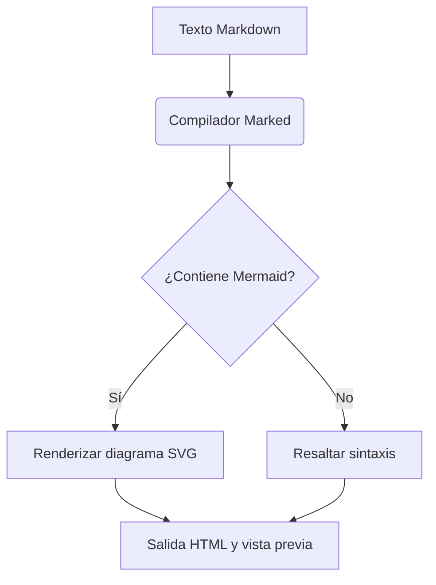

# Conversor de Markdown a HTML 🚀

¡Bienvenido al **Conversor de Markdown a HTML**! Esta herramienta ofrece un espacio de trabajo instantáneo a pantalla dividida para redactar la estructura de tus documentos, compilar un marcado HTML impecable e inyectar diseños CSS personalizados en tiempo real.

## Funciones principales

1. **Pestañas de salida dobles**: cambia al instante entre **Vista previa** (el diseño renderizado) y **Código** (el HTML compilado en un editor de solo lectura).
2. **Estilos dinámicos en vivo**: pulsa el botón **Estilos** de la cabecera para abrir el panel de personalización. Escribe CSS propio o elige un preajuste de tema para dar estilo a tu HTML al instante.
3. **Arquitectura adaptable**: un espacio de trabajo totalmente adaptado que responde con gran rapidez.

---

### Demostración de resaltado de código

Aquí tienes un breve fragmento de TypeScript que muestra el renderizado de highlight.js:

```typescript
export class CodeCraftsmanship {
  readonly isAwesome = true;
  constructor(private name: string) {
    console.log(`Crafting high-quality software with ${name}`);
  }
}
```

### Demostración de diagramas Mermaid

Aquí tienes un diagrama de flujo de Mermaid renderizado en vivo:



> Crear herramientas elegantes exige entender lo fundamental, evitar atajos y cuidar los detalles. ¡Vamos a crear algo bonito!
